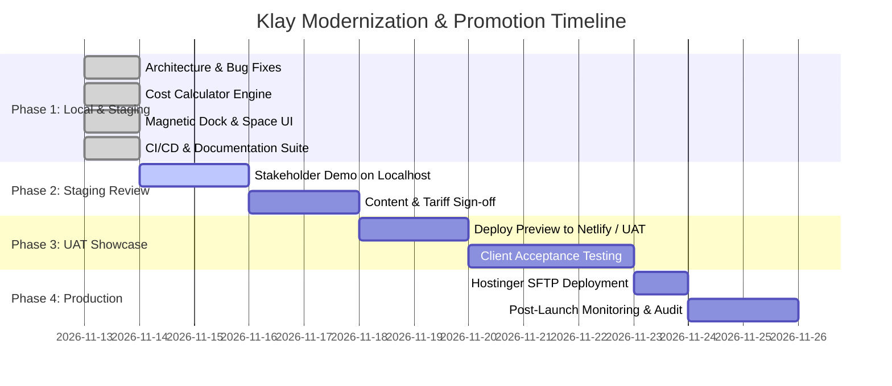

# Project Timeline & Milestones (`TIMELINE.md`)

This timeline tracks the modernization, review checkpoints, and deployment stages for Klay Consultants.

---

## Milestone Roadmap



---

## Detailed Milestone Checklist

| Milestone | Status | Description | Rollback Point |
| :--- | :---: | :--- | :--- |
| **M1: Baseline Stabilization** | ✅ Complete | Fixed AboutPage H1 error, video prop leakage, cleaned root JSON files. | `klay-v0.1-baseline` |
| **M2: Staging & Calculator Ready** | ✅ Complete | Replaced Fillout iframe with native Cost Calculator, integrated Magnetic Dock, added .env configs, CI/CD, and docs. | `klay-v0.2-staging-ready` |
| **M3: Equitify Architecture & Staging Polish** | ✅ Complete | Executive single-fold light calculator, Business Setup video hero & persistent dock, instant gold ticket shader, and 5-group eligibility cycler. | Branch: `staging` (`8ccc544`) |
| **M4: Dual Netlify Deployment (Staging & UAT)** | ✅ Complete | Deployed `https://klay-consulting-staging.netlify.app` (new) and `https://klay-consulting-uat.netlify.app` (preserved last night build). | `klay-consulting-staging` / `klay-consulting-uat` |
| **M4.5: Interactive Prototypes & Logic Simulator** | ✅ Complete | Locked in Cost Calculator Variant C (Sliders/Matrix), Golden Visa Variant C (Quiz), and Option 3 standalone sovereign pricing simulator (`/pricing-engine-demo.html`). | Commit `HEAD` on `staging` |
| **M5: Production Cutover** | ⏳ Pending | Automated deploy to Hostinger `public_html` via GitHub Actions SFTP after client sign-off. | Tag: `v2.0.0-prod` |

---

## Time Machine Quick Commands

- **View all milestones**:
  ```bash
  ./scripts/time-machine.sh list
  ```
- **Check differences against baseline**:
  ```bash
  ./scripts/time-machine.sh diff klay-v0.1-baseline
  ```
- **Roll back to previous checkpoint**:
  ```bash
  ./scripts/time-machine.sh rollback klay-v0.1-baseline
  ```
